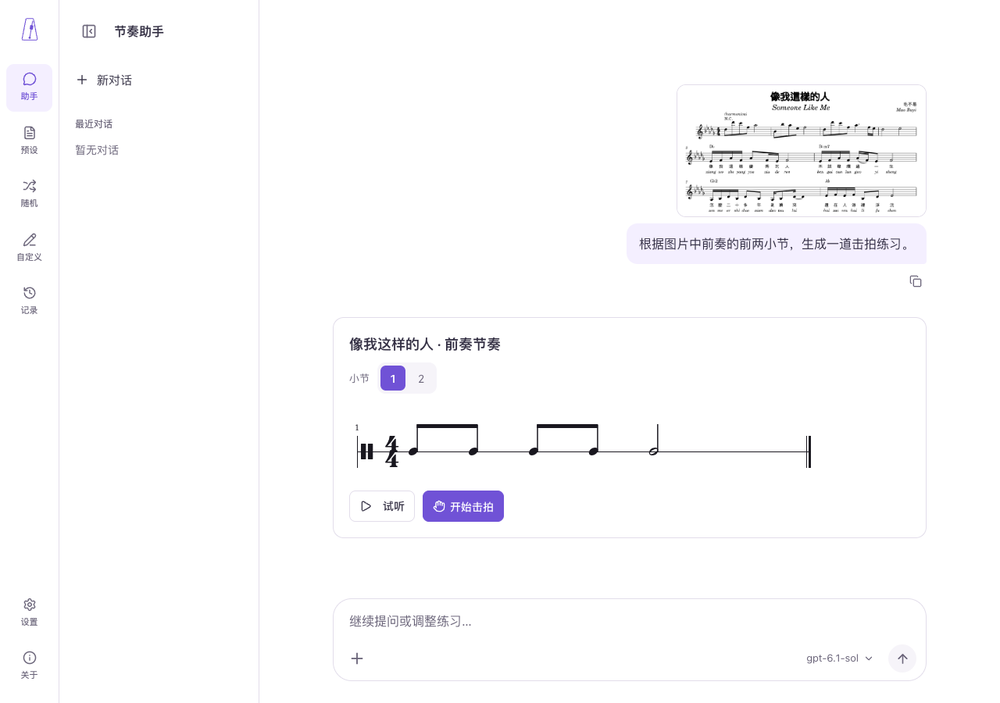
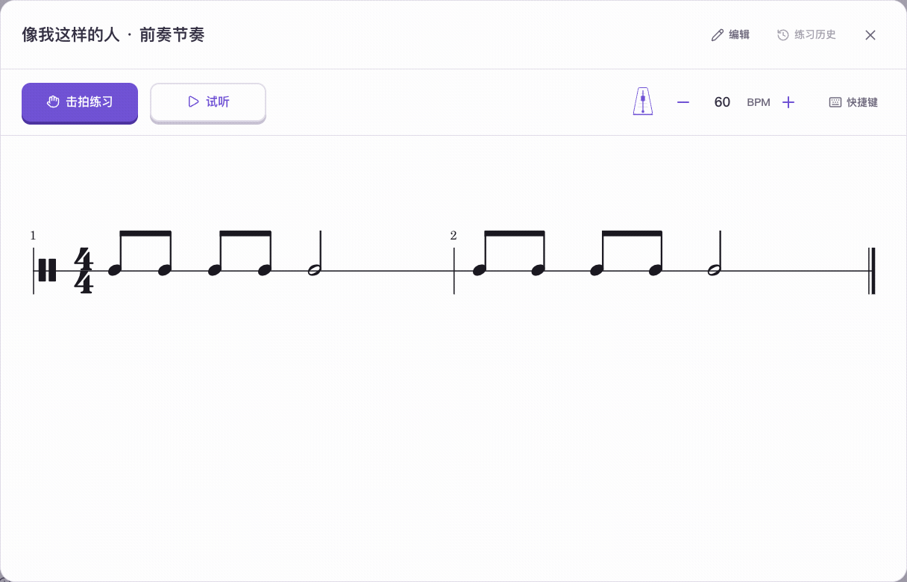
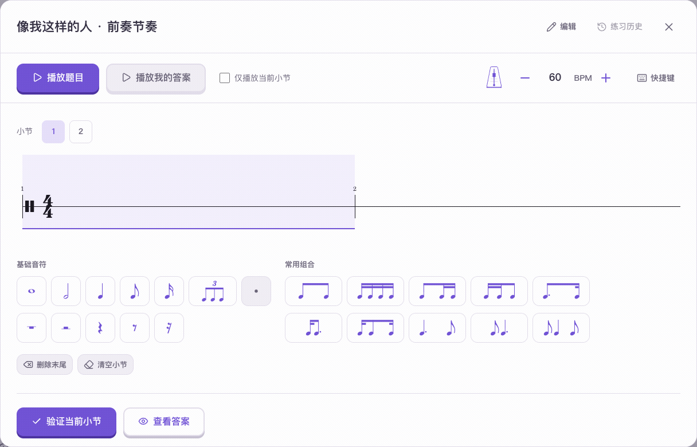

# 节奏训练

面向音乐自学者的节奏训练工具，哪里不会练哪里：练什么内容、多少BPM、练哪一小节，都由你自己掌控。



## 核心功能

- **按自己的需要练**
  - **击拍与听写**：支持击拍练习、节奏听写练习。
  - **自选内容**：预设题目、随机生成、自定义编写，或由 AI 根据文字、乐谱图片辅助出题；支持编辑 AI、随机和自定义题目，并保存到自己的题库。
  - **针对难点练习**：击拍时可从指定小节练到结尾，也可只练当前小节；听写支持单小节播放、逐小节作答与验证；自由调整 BPM，选择适合自己的速度。

- **AI 节奏助手**
  - 支持多轮问答、节奏讲解，以及文字和乐谱图片输入。
  - 根据你的要求生成对应的击拍或听写练习题目。
  - 结合当前题目和练习表现，帮助分析问题、提供练习建议。
  - 支持通过 **DeepSeek API Key** 或 **ChatGPT 订阅授权**接入模型。

- **练习记录与复盘**
  - 保存击拍与听写记录，查看每道题的历史结果和单次练习详情。
  - 按时间、练习模式筛选，查看练习次数、练习天数及次数趋势。

## 功能演示

### 击拍练习

试听节奏，按空格键击拍，查看每次击拍的准确度与整轮结果。



### 节奏听写

聆听题目，填写节奏，逐小节验证答案，完成整段节奏听写。



## 快速启动（Docker）

1. 下载项目并复制配置文件：

   ```sh
   git clone https://github.com/Emmet-Ray/a-rhythm-trainer.git
   cd a-rhythm-trainer
   cp .env.example .env
   ```

2. 启动：

   ```sh
   docker compose up -d --build
   ```

打开 <http://localhost:8080> 即可使用。使用 AI 助手前，在「设置 → 模型服务」中配置模型。

## 技术栈

- **前端**：React、TypeScript、Vite；React Router（路由）、Lucide（图标）、react-markdown（Markdown 渲染）、VexFlow（谱面渲染）、Web Audio API（音频与节拍调度）；AI SDK UI（助手流式消息）
- **后端**：Python、FastAPI；SQLite、SQLAlchemy、Alembic（数据存储与迁移）；Pydantic AI（模型接入与工具调用）、OpenAI Python SDK（DeepSeek 与 ChatGPT 订阅 Responses）
- **部署**：Docker、Nginx

## TODO

### 新增功能

- [ ] AI 节奏助手
  - [x] AI对话助手，支持生成击拍练习、听写练习并开始练习
  - [x] 编辑保存 AI 生成的题目
  - [x] 页面上下文：练习与编辑、题目目录、生成设置、练习记录和设置页
  - [x] 会话持久化
  - [x] 模型切换与认证
  - [x] 图片输入
  - [ ] 搜索功能
- [ ] 几何节奏游戏模式
  - [x] 四分、八分、十六分、三连音及附点、切分小游戏：关卡选择、双球轨道、错拍结束与重试
  - [x] 原创音乐关《微光》：伴奏、命中旋律与分段视觉反馈
- [ ] 自定义练习题目：支持文件导入
- [ ] 支持输入与音频输出延迟校准

### 功能改进

- [ ] 支持更多拍号与节奏记谱方式
  - [x] 4/4, 2/4, 3/4
- [ ] 调整预设题目的内容安排
- [ ] 练习记录
  - [ ] 同一道题目的练习记录图表
- [ ] 声音设置与反馈
  - [x] 练习与节拍器音色选择，切换时自动试听
  - [x] 击拍声音自然衰减，连续敲击支持有限尾音重叠
  - [ ] 节拍器音量调节
  - [ ] 节拍器重音设置

### 界面与交互

- [ ] 检查UI/UX一致性
- [ ] 为预设题目提供不同视图（目前都是文字）

### 文档

- [ ] 更新根目录README
  - [ ] 新的demo图片、gif
