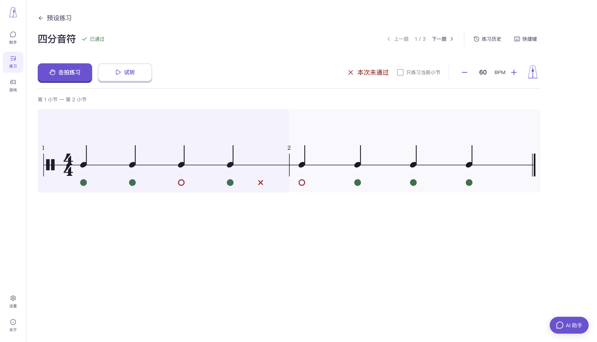
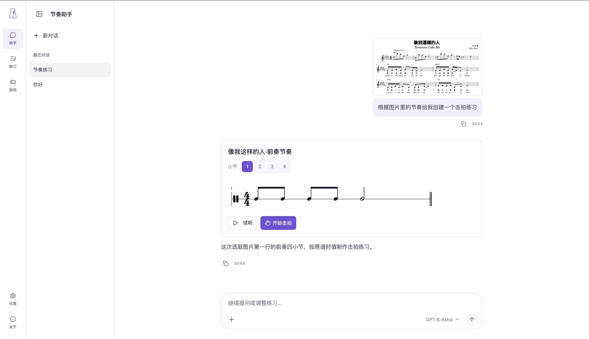

# 节奏训练

哪里不会练哪里，面向音乐自学者的节奏训练工具：看谱击拍、听音写谱，也可以通过单键节奏游戏练习。自由调整速度，把难点单独拿出来反复练，再根据反馈检查自己的节奏偏差。

内置预设题库，支持随机出题、自定义谱面和 AI 辅助生成练习。基础练习无需配置模型；使用 AI 助手时再连接模型服务。

[快速开始](#快速开始) · [界面预览](#界面预览) · [核心功能](#核心功能) · [开发与扩展](#开发与扩展)

## 界面预览

### 看谱击拍

试听谱面，按空格键击拍。练习结束后查看逐拍反馈，调整 BPM 或从指定符号开始，再练一次。



### 把问题变成练习

输入要求或上传乐谱图片，让 AI 助手讲解节奏、生成题目，并结合当前题目和练习表现继续交流。



### [更多预览内容](demo/README.md)

## 核心功能

- **看谱击拍**：试听谱面，按空格键击拍，查看准确度和逐拍判定反馈。自由调整 BPM，支持从指定音符或休止符开始练习。
- **节奏听写**：聆听节奏并填写谱面，播放自己的答案，逐小节验证；支持单独播放和练习某个小节。
- **选题与 AI 助手**：从预设、随机或自定义题目开始，也可以通过文字或乐谱图片让 AI 讲解节奏、生成练习。随机、AI 和自定义题目均可编辑并保存。
- **练习记录**：保存击拍与听写结果，回看每道题的历史记录和单次练习详情；按时间与模式筛选，查看练习次数、练习天数及变化趋势。
- **节奏游戏**：采用类似[《冰与火之舞》](https://store.steampowered.com/app/977950/A_Dance_of_Fire_and_Ice/)的单键双球玩法，支持观看示范、调整速度和指定练习范围。内置基础节奏关卡与 AI 原创曲目《微光》，支持自行修改和创建关卡。

## 快速开始

### Docker 启动

```sh
git clone https://github.com/Emmet-Ray/a-rhythm-trainer.git
cd a-rhythm-trainer
cp .env.example .env
docker compose up -d --build
```

打开 <http://localhost:8080> 即可使用。

### 热加载模式

```sh
docker compose -f compose.dev.yaml up --build --watch
```

打开 <http://localhost:8081> 即可使用。

### 可选：配置 AI 助手

在「设置 → 模型服务」中配置模型。目前支持 DeepSeek API Key 和 ChatGPT 订阅授权。

## 开发与扩展

想在本地开发、整理题库或制作游戏关卡，可以从以下文档开始：

- [前端开发与部署](frontend/README.md)：本地启动、构建与浏览器验收
- [后端运行与维护](backend/README.md)：模型配置、数据备份与接口联调
- [架构说明](docs/ARCHITECTURE.md)：模块职责、状态归属与记录规则
- [预设题库编辑与发布](content/README.md)：维护和校验预设练习
- [游戏关卡制作](.agents/skills/create-rhythm-level/SKILL.md)：让你的Agent（Codex/Claude Code/...）使用关卡制作skill来制作关卡

## 技术栈

前端使用 React、TypeScript 和 Vite；谱面由 VexFlow 渲染，音频由 Web Audio API 调度，节奏游戏使用 Phaser 4。后端使用 FastAPI 和 SQLite，AI 助手通过 Pydantic AI 接入模型，支持 Docker 部署。

## TODO

### 新增功能

- [ ] AI 节奏助手
  - [x] AI对话助手，支持生成击拍练习、听写练习并开始练习
  - [x] 编辑保存 AI 生成的题目
  - [x] 页面上下文：练习与编辑、题目目录、生成设置、练习记录和设置页
  - [x] 会话持久化
  - [x] 模型切换与认证
  - [x] 图片输入
  - [ ] 搜索功能
- [ ] 自定义练习题目：支持文件导入
- [ ] 支持输入与音频输出延迟校准

### 功能改进

- [ ] 支持更多拍号与节奏记谱方式
  - [x] 4/4, 2/4, 3/4
- [ ] 调整预设题目的内容安排
- [ ] 练习记录
  - [ ] 同一道题目的练习记录图表
- [ ] 声音设置与反馈
  - [x] 练习与节拍器音色选择，切换时自动试听
  - [x] 击拍声音自然衰减，连续敲击支持有限尾音重叠
  - [ ] 节拍器音量调节
  - [ ] 节拍器重音设置

### 界面与交互

- [ ] 检查UI/UX一致性
- [ ] 为预设题目提供不同视图（目前都是文字）

### 文档与demo

- [ ] 梳理更新关卡制作skill
- [ ] 更新demo：新音色库

## 致谢

- [GeneralUser GS](https://github.com/mrbumpy409/GeneralUser-GS)（GeneralUser GS License v2.0）：音色库
- [claude pxl](https://github.com/crsolver/claude-pxl)（MIT）：像素美术工具与skill

## 许可

项目代码采用 [MIT License](LICENSE)。第三方音源、字体等资源保留各自许可，详见对应资源目录中的许可文件。
