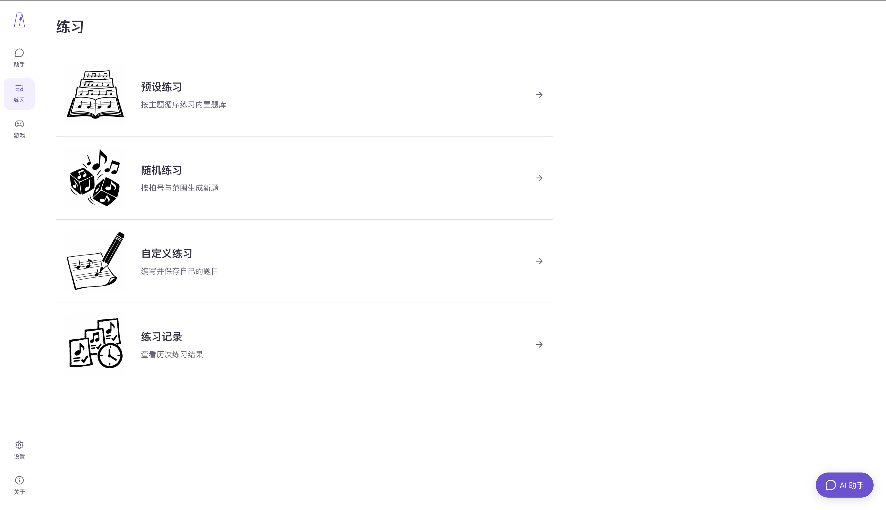
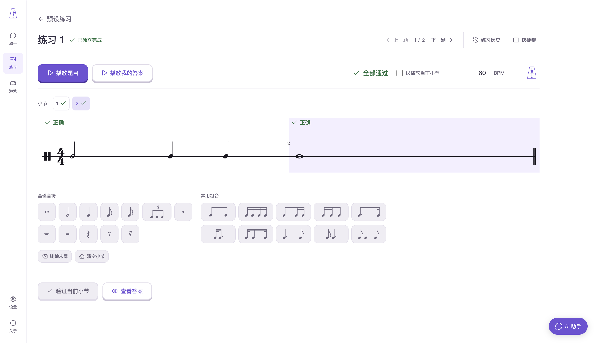
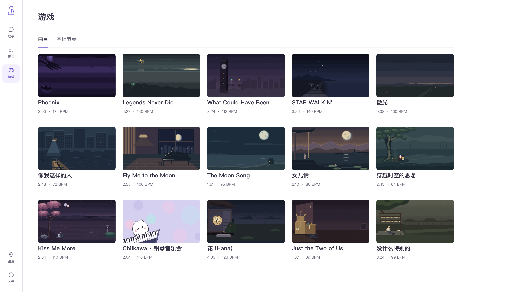
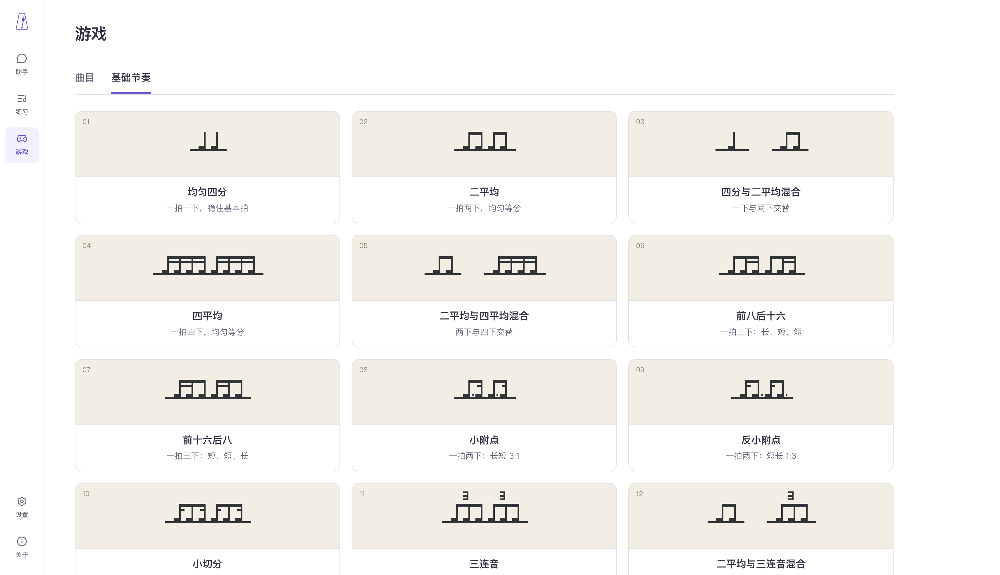
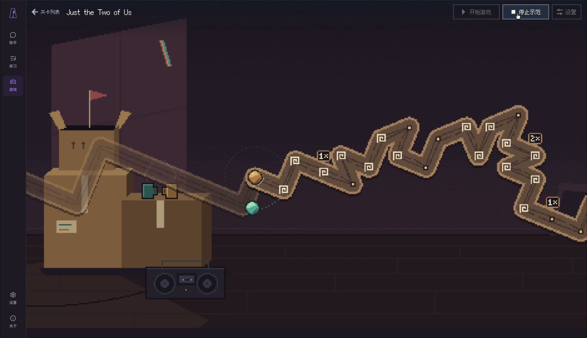

# 功能演示

## 助手

输入文字要求或上传乐谱图片，让助手生成节奏练习；可以直接试听和开始击拍，也可以继续对话调整题目。

## 练习

从预设题库、随机生成或自定义题目进入练习，在练习记录中回看结果。

### 击拍练习

试听谱面，按空格键击拍。练习结束后，对照每一拍的反馈找出偏差，调整速度或只练当前小节，再试一次。

### 节奏听写

聆听题目，用音符与常用节奏组合填写答案；支持播放自己的答案，并逐小节验证。

## 游戏

敲击空格，跟随节奏控制双球沿轨道前进，可以先看示范，再调整 BPM 和练习范围进行挑战。

> 公开仓库内置基础节奏关卡与 AI 原创曲目《微光》。下方曲目目录截图与《Just the Two of Us》视频包含本地扩展曲目，不随公开仓库提供；可按[游戏内容制作说明](../frontend/src/game-content/README.md)自行扩展关卡。

### 曲目（含本地扩展）

### 基础节奏

### 本地扩展关卡示范：Just the Two of Us

[点击查看视频](videos/just-the-two-of-us.mp4)

