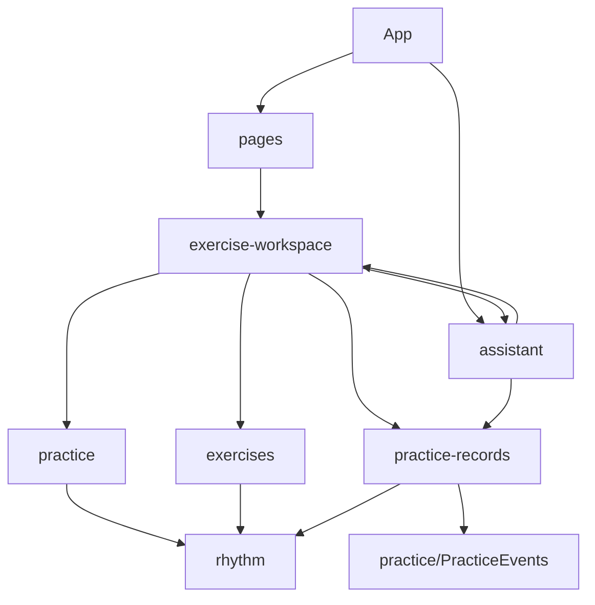

# 模块边界与状态归属

本文维护模块职责、跨模块契约和设计理由。运行方式见前后端 README，音频判定详见 [TIMING](../frontend/TIMING.md)。
按独立能力与应用组装划分目录，不要求每个功能都有相同的分层。

## 前端模块

| 模块 | 拥有的职责与边界 |
| --- | --- |
| `rhythm/` | 节奏模型、音乐时值、时间线、判定、音频和记谱；不依赖应用功能 |
| `practice/` | 训练、作答、节奏输入及训练事件契约；不处理保存、路由恢复或助手 |
| `exercise-workspace/` | 练习／编辑组装、草稿恢复、保存副本、来源操作，以及记录与助手连接 |
| `exercises/` | 题目结构、预设加载、随机生成及 AI 临时题目；不负责训练 |
| `practice-records/` | 事实累计、校验、查询、串行保存、重试和历史展示；不导入助手 |
| `assistant/` | 对话、模型选择、消息 UI、上下文投影与活动批次；不导入页面 |
| `pages/` | 解析地址、选择题目来源、组装路由功能 |
| `navigation/` | 访问恢复、滚动／焦点、未保存保护、路由预加载；不缓存服务器数据或运行音频 |
| `ui/` | 通用提示、加载占位和退出动效；不持有业务状态 |
| `settings/` | 偏好及配置界面；训练开始时读取音色与精度快照，不追随本轮中的偏好变化 |
| `query/` | TanStack Query 客户端与应用级默认策略；不定义业务查询 |
| `api/` | 题库、助手和模型连接的 HTTP 边界；题库模块同时拥有查询定义和写入后的缓存失效 |
| `brand/` | 品牌视觉组件 |
| `App.tsx` | 长生命周期资源与应用组装；连接记录详情和助手，保持助手跨路由挂载 |

图中表示主要功能连接。助手卡片可以打开工作区，应用组装层因此允许双向连接；底层节奏、训练和记录保持上述独立边界。
记录和自定义题库查询使用 TanStack Query；`query/queryClient` 配置应用级缓存，业务模块定义查询身份与写入后的失效范围。同题历史摘要直接读取该缓存，不另存副本。默认读取失败手动重试，窗口重新聚焦时刷新过期查询；记录列表自行更新查询时间范围。加载展示规则见 [DESIGN](../frontend/DESIGN.md#布局与内容稳定)。
`navigation` 的路由预加载允许知道页面和工作区。导入约束由 [validate-module-boundaries.mjs](../frontend/scripts/validate-module-boundaries.mjs) 检查。

## 状态与生命周期

| 状态 | 拥有者 | 恢复与清理约定 |
| --- | --- | --- |
| 本轮时钟、音频与判定 | `practice` 与音频模块 | 开始建立，停止／换题／卸载释放；自然结束后的迟到修正规则见 TIMING |
| 听写作答与编辑草稿 | 工作区，训练使用受控状态 | 按访问恢复，核对题目编号与内容；不恢复播放或结果遮罩 |
| 访问快照与浏览偏好 | `navigation/PageVisits` | 当前应用内保留，刷新丢弃；历史返回恢复原快照，新访问可继承浏览偏好 |
| 本次事实与待保存批次 | `usePracticeRecorder` | 按访问累计；已提交写入离页后继续，失败保留供站内返回重试 |
| 已加载同题历史 | `practiceRecordStorage` | 页面按需请求，只读入口不隐式发请求 |
| 助手消息与运行 | `assistant/conversation` | 跨路由保持挂载；正式历史由后端持有，恢复契约见后端 README |
| 待发送练习活动 | `PracticeActivity` | 确认只清理已发送版本，新结果留给下一批；待发活动不跨刷新保存 |
| 当前页面与子面板上下文 | `AssistantContext` | 按访问隔离，浮层只注册／清理自己的区段 |
| AI 临时题目与答案曝光 | `GeneratedExerciseStore` | 临时题目随应用生命周期；同一 ID 的答案曝光不可因折叠撤销 |

外观、音色、击拍精度、助手宽度与当前对话 ID 保存在浏览器；题库、记录、对话和模型连接的持久化及备份见 [后端说明](../backend/README.md#数据与备份)。
自定义题库的击拍／听写模式共用列表挂载，分页与滚动仍按模式和访问恢复；进入训练或编辑仍按访问重建。
BPM 和节拍器按访问及设置作用域管理，不保存到题库；随机换题保留同模式的设置，用新 ID 隔离题目、作答、编辑草稿和尝试。练习与编辑共用设置，刷新不恢复运行中的轮次。

## 题目、记录与保存

工作区拥有首次保存身份：AI、随机题目创建自定义副本，自定义题目更新原题；同一工作区后续保存更新已保存副本。
保存失败保留草稿，保存只清理已提交版本，不能覆盖保存期间的新编辑。听写进入编辑会公开标准答案，保存后的新内容不继承旧作答。

档案按来源、题目 ID、模式与规范化谱面归并；名称和速度不拆档，改谱面形成另一版本。随机换题使用新 ID，即使谱面相同也属另一题。
击拍一轮使用稳定尝试 ID，自然结束后的修正更新同轮；试听不记录，主动停止规则见 TIMING。
击拍支持点选起始小节及仅练当前小节；实际范围覆盖整首才创建尝试。局部练习仅显示本轮反馈，不累计历史、统计或助手活动；单小节题目仍属完整练习。
听写一份空白作答使用一个 ID，首次有效听题、验证或查看答案创建；仅编辑不创建。编辑撤销本小节旧判定，重复验证未改答案不增加次数。
全部小节正确后冻结尝试，之后复盘不改成绩；历史返回延续原尝试，新访问从空白开始。

列表统计按尝试与时间／模式筛选，详情展示单题全部历史；详情分页不改变统计，删除档案会删除其全部尝试。
击拍按完成时间、听写按开始时间筛选；日数和次数趋势按请求时区的本地日历计算。趋势覆盖完整筛选范围，不受分页影响；缺失日期补零，跨度超过 90 天按月汇总。独立完成指完成前未看答案。

## 记录与助手的连接

训练用 `PracticeEvents` 报告事实，记录先累计，通过 `onAttemptChanged` 通知工作区，再持久化；工作区连接活动收集。因此保存失败仍能分析本次结果。
摘要显式接收历史及状态：`available`、`not-loaded`、`read-error`、`unavailable`；已确认无记录是 available 且总数为零。
准备消息时读取最新已加载历史，摘要排除本次尝试以免重复统计；历史失败不能解释为没有练习。

页面快照描述当前工作区，活动批次描述期间的新结果；最近产生结果的题目可以成为默认讨论对象，关闭覆盖层后不被背景页面覆盖。
记录详情通过应用提供的可选内容插槽发布当前分页上下文，无需导入助手。首页与侧栏共用助手实例，路由切换不能重建输入框或对话。
听写未公开时只投影用户作答与验证事实，不附带标准谱面；模型层的额外保密约束见后端 README。

## 后端模块

| 模块 | 职责与边界 |
| --- | --- |
| `api/` | 请求校验、资源／事务协调与 HTTP 错误转换；不拼记录查询 SQL |
| `domain/` | 不依赖 HTTP 或数据库的节奏与记录规则，包括谱面等价比较 |
| `db/` | 连接、题库与记录存取；`practice_record_queries.py` 集中分页、排序、筛选和统计 |
| `assistant/sessions.py`、`journal.py` | 会话运行／恢复与检查点协调、JSONL 文件边界 |
| `assistant/messages.py`、`context.py` | 模型／UI 消息转换与图片校验、助手指令与快照时间语义 |
| `assistant/connections.py`、`providers/`、`model.py` | 凭证与客户端生命周期、供应商接入、公共模型与错误契约 |
| `assistant/tools/` | 生成练习参数与业务校验；只返回练习，不保存题库 |
| `migrations/`、`tests/` | 已发布结构演进、临时数据与模拟模型回归 |

数据库写锁覆盖档案查找与尝试写入，创建重试不能覆盖较新结果，删除后的更新返回缺失错误。HTTP 层持有 Session／事务，查询模块隐藏关联与聚合。
`domain/rhythm.score_identity` 用于谱面等价比较，省略附点与显式零附点等价，不修改传入内容；数据库不另存内容指纹。
供应商接入不直接读写连接文件或持有会话历史；通用模型与工具循环交给 Pydantic AI，应用只协调业务生命周期。
